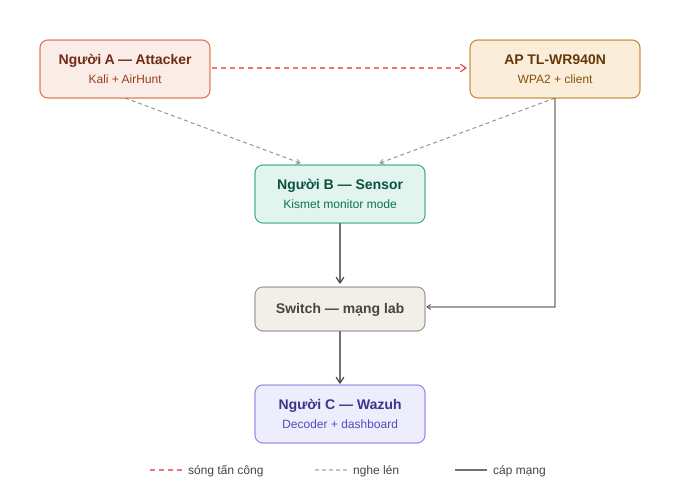

<div align="center">

# WISE · Wireless Attack & Detection Lab

**Nghiên cứu tấn công mạng không dây bằng AirHunt và xây dựng hệ thống giám sát – phát hiện xâm nhập (WIDS) trên thiết bị thực bằng Wazuh.**


[Kế hoạch](docs/01-ke-hoach/roadmap.md) · [Hướng dẫn nhóm](docs/02-huong-dan/huong-dan-nhom.md) · [Kịch bản demo](docs/03-kich-ban/kich-ban-demo.md) · [Kết quả](docs/04-ket-qua/) · [Báo cáo](docs/05-bao-cao/)

</div>

---

> [!WARNING]
> **Cảnh báo pháp lý & đạo đức.** Toàn bộ kỹ thuật tấn công trong dự án này **chỉ** được thực hiện
> trên **thiết bị của chính nhóm**, trong một **mạng lab cách ly**, phục vụ mục đích học thuật của
> môn học. Tấn công (deauth, bắt handshake, WPS, PMKID…) nhắm vào mạng Wi-Fi của người khác mà
> không được phép là **vi phạm pháp luật**. Nhóm không chịu trách nhiệm cho bất kỳ việc sử dụng sai
> mục đích nào.

## Dự án này là gì

Một **lab tấn công – phòng thủ** hoàn chỉnh cho mạng không dây: một bên tấn công Wi-Fi bằng công cụ
AirHunt, một bên dựng hệ thống giám sát Wazuh để **phát hiện** cuộc tấn công theo thời gian thực,
rồi **vá lỗi và kiểm chứng** tấn công thất bại. Khác với các đồ án chỉ "crack được wifi", dự án này
đo được **hệ thống giám sát mạnh ở đâu và mù ở đâu** — đúng tư duy phòng thủ thực tế.

## Bạn có gì trong tay

| | Thành phần | Vị trí | Vai trò |
|---|---|---|---|
| 🔴 | Kịch bản tấn công (AirHunt) | [docs/03-kich-ban](docs/03-kich-ban/kich-ban-demo.md) | 6 màn: deauth, handshake, WPS, PMKID |
| 🔵 | Decoder + Rule phát hiện | [code/wazuh](code/wazuh/) | Bắt deauth flood / WPS / rogue AP trên Wazuh |
| 🔵 | Cảm biến WIDS | [code/sensor](code/sensor/sensor-wids.py) | tshark bắt frame deauth → log cho Wazuh |
| ⚪ | Kế hoạch 7 phase | [docs/01-ke-hoach](docs/01-ke-hoach/roadmap.md) | Chia việc, thứ tự, phụ thuộc |
| ⚪ | Hướng dẫn từng người | [docs/02-huong-dan](docs/02-huong-dan/huong-dan-nhom.md) | Cấu hình máy A/B/C chi tiết |
| ⚪ | Sơ đồ kiến trúc | [assets/so-do](assets/so-do/) | 2 sơ đồ SVG cho báo cáo |

Chú thích: 🔴 tấn công (Red team) · 🔵 phòng thủ (Blue team) · ⚪ kế hoạch & tài nguyên

## Kiến trúc tổng thể



```
Attacker (Huy) ─tấn công không dây→ AP TL-WR940N + client (nạn nhân)
                                         ╎ (Sensor nghe lén qua monitor mode)
Sensor (Hưng) → tshark bắt frame → log → Wazuh agent ─cáp→ Wazuh manager (Khang)
                                             → decoder bóc trường → rule xét ngưỡng → 🚨 ALERT
```

## Bắt đầu — đọc theo mục tiêu

| Bạn muốn… | Đọc file |
|---|---|
| Hiểu tổng thể dự án trong 5 phút | file README này |
| Biết mình (A/B/C) phải làm gì, cấu hình máy ra sao | [docs/02-huong-dan/huong-dan-nhom.md](docs/02-huong-dan/huong-dan-nhom.md) |
| Nắm thứ tự làm việc, chia phase, phụ thuộc | [docs/01-ke-hoach/roadmap.md](docs/01-ke-hoach/roadmap.md) |
| Xem chi tiết từng màn demo + số liệu đo | [docs/03-kich-ban/kich-ban-demo.md](docs/03-kich-ban/kich-ban-demo.md) |
| Cài hệ thống phát hiện Wazuh | [code/wazuh/README.md](code/wazuh/README.md) |

## Cấu trúc thư mục

```
WISE/
├── README.md                     # mục lục dẫn đường (file này)
├── docs/                         # TÀI LIỆU
│   ├── 01-ke-hoach/              # roadmap, chia phase, phân công
│   ├── 02-huong-dan/            # hướng dẫn cài đặt từng người
│   ├── 03-kich-ban/            # kịch bản demo chi tiết + số liệu
│   ├── 04-ket-qua/           # (điền khi chạy lab) số liệu, minh chứng
│   └── 05-bao-cao/          # (viết ở cuối) các chương báo cáo
├── code/                         # MÃ NGUỒN
│   ├── wazuh/                   # decoder + rule + hướng dẫn cài
│   └── sensor/                 # cảm biến tshark (sensor-wids.py)
├── assets/so-do/               # SƠ ĐỒ (SVG)
├── .githooks/                  # hook chặn push lên main
└── setup.sh                    # bật hook sau khi clone
```

## Nhóm & vai trò

| Người | Vai | Máy | Phụ trách |
|---|---|---|---|
| **Huy** | 🔴 Attacker (A) | Máy inject được | AirHunt, các màn tấn công |
| **Hưng** | 🔵 Sensor (B) | Máy monitor mode | Cảm biến tshart/Kismet, chuyển log |
| **Khang** | 🔵 Blue team (C) | Wazuh + hạ tầng | Wazuh, router/switch, đi dây |

## Kết quả (cập nhật khi chạy lab)

> Điền số liệu thực nghiệm vào [docs/04-ket-qua](docs/04-ket-qua/) sau Phase 5.

- [ ] Thời gian phát hiện deauth flood trung bình: `___ giây`
- [ ] Tỉ lệ phát hiện đúng: `___ %`
- [ ] False positive (baseline): `___`
- [ ] Minh chứng vá lỗi: deauth trước vá (thành công) vs sau vá 802.11w (thất bại)

## Quy ước git của nhóm

- **Không push trực tiếp lên `main`.** Mỗi người push lên branch riêng rồi tạo Pull Request.
- Sau khi clone, chạy một lần để bật hook chặn push `main`:
  ```bash
  sh setup.sh
  ```

## Môn học & tài liệu

Môn **An Toàn Mạng Không Dây và Di Động** (WISE432380). Dự án phủ các chuẩn đầu ra
**G1.2, G2.1, G2.2, G4.1, G4.2** (chi tiết: [kịch bản mục 6](docs/03-kich-ban/kich-ban-demo.md)).

- [1] Aaron E. Earle. *Wireless Security Handbook*. Auerbach, 2006 — giáo trình chính.
- [2] W. Osterhage. *Wireless Network Security, 2nd ed.* CRC Press, 2018.
- Tài liệu chính thức: [Wazuh](https://documentation.wazuh.com/), [Kismet](https://kismetwireless.net/), [Aircrack-ng](https://www.aircrack-ng.org/).

---

<div align="center">
<sub>Đồ án học thuật · chỉ dùng trong lab cách ly của nhóm · không nhằm mục đích tấn công thực tế</sub>
</div>
