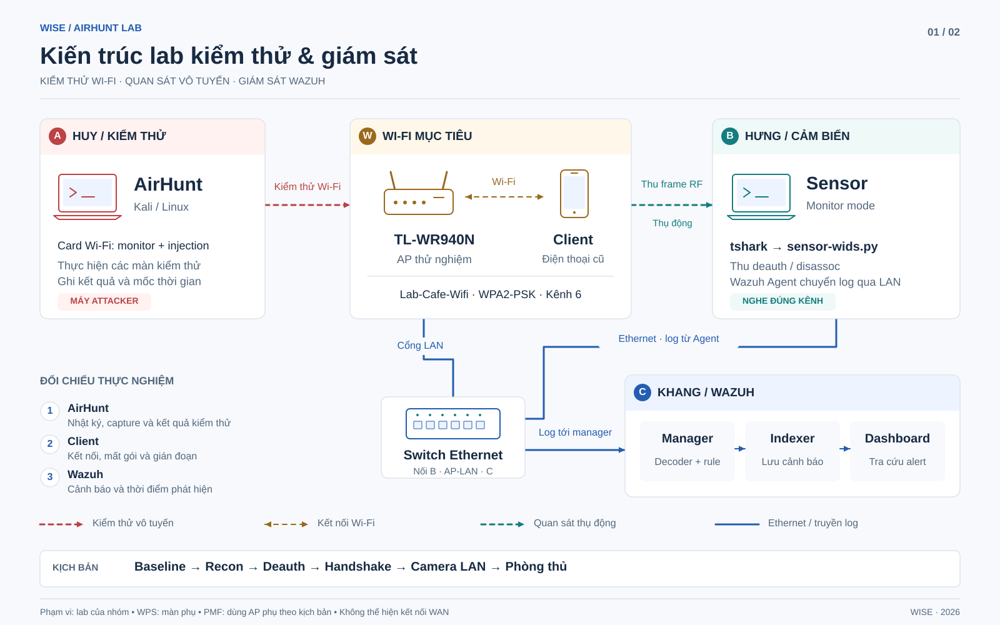
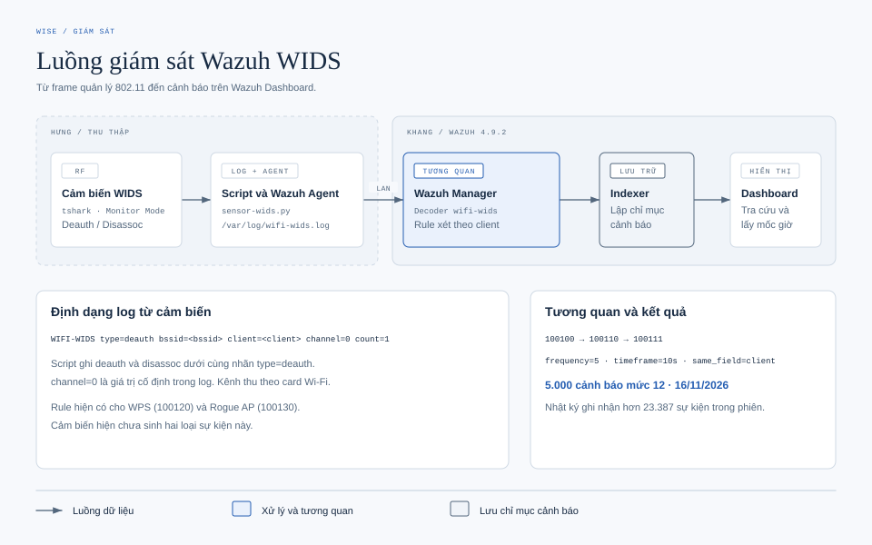
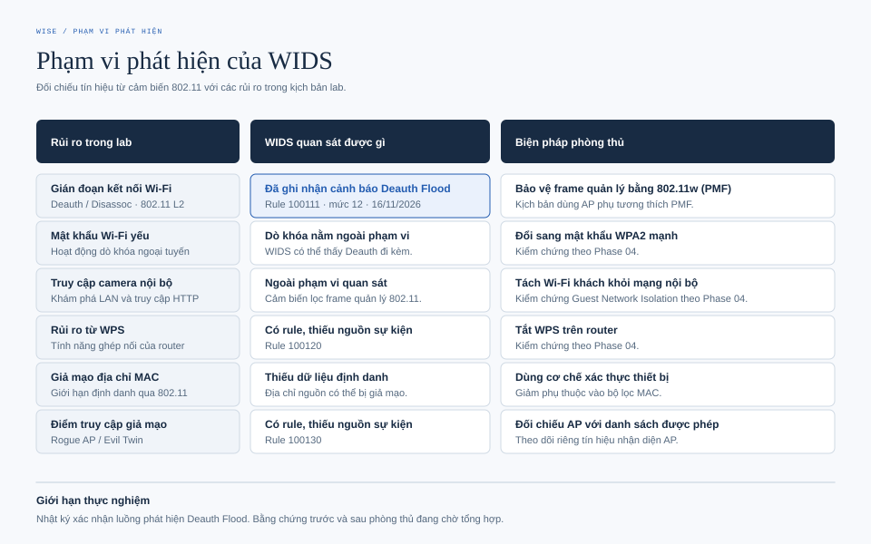

<div align="center">

# WISE · Wireless Attack & Detection Lab

**Nghiên cứu chuỗi tấn công từ mạng Wi-Fi yếu đến lộ Camera nội bộ bằng AirHunt & Nmap, kết hợp xây dựng hệ thống giám sát – phát hiện xâm nhập không dây (WIDS) trên thiết bị thực bằng Wazuh.**


[](LICENSE)

[Kịch bản tổng thể](docs/03-kich-ban/kich-ban-demo.md) · [Checklist 7 Phase](docs/03-kich-ban/phase/README.md) · [ROE](docs/ROE.md) · [ATT&CK Mapping](docs/ATTACK_MAPPING.md) · [Kết quả & Nhật ký Lab](docs/04-ket-qua/) · [Pháp lý & Đạo đức](docs/LEGAL_ETHICS.md)

</div>

---

> [!WARNING]
> **Cảnh báo pháp lý & đạo đức.** Toàn bộ kỹ thuật kiểm thử trong dự án này **chỉ** được thực hiện
> trên **thiết bị thuộc sở hữu của chính nhóm** (Router TL-WR940N, iPhone đóng vai IP Camera chỉ quay tờ giấy mã cảnh `DEMO-01`/`DEMO-02`, và 3 laptop thành viên) trong một **mạng lab cách ly**, phục vụ mục đích học thuật của môn học.
> Tấn công mạng Wi-Fi hoặc truy cập camera của người khác khi không được phép là **vi phạm pháp luật**.
> Chi tiết điều kiện và cơ sở pháp lý: [docs/LEGAL_ETHICS.md](docs/LEGAL_ETHICS.md).

## 1. Dự án này là gì?

Một **phòng lab Tấn công – Giám sát – Phòng thủ (Red / Sensor / Blue)** hoàn chỉnh trên thiết bị phần cứng thật, mô phỏng bối cảnh một **quán cà phê / văn phòng nhỏ** dùng chung mạng Wi-Fi cho khách và camera quan sát nội bộ:

1. **🔴 Vế Công (Red Team — Huy):** Dùng **AirHunt** thực hiện trinh sát vô tuyến, bắn **Deauthentication Flood** ép thiết bị ngắt kết nối để bắt **4-Way Handshake**, crack mật khẩu WPA2 yếu, sau đó kết nối vào mạng LAN dùng **Nmap** tìm cổng dịch vụ và mở xem trực tiếp luồng hình ảnh từ **iPhone IP Camera nội bộ** (`SimpleIPCamera`).
2. **🔵 Vế Giám sát (Wireless Sensor — Hưng & Wazuh SIEM — Khang):** Cảm biến `tshark` (`code/sensor/sensor-wids.py`) lắng nghe ở chế độ Monitor Mode, đẩy log qua cáp LAN về **Wazuh Manager** để bóc tách trường và **nổ cảnh báo mức 12 (Rule 100111 — Deauth Flood)** theo thời gian thực ngay từ đầu chuỗi tấn công.
3. **🛡️ Vế Phòng thủ & Kiểm chứng (Mitigation — Cả nhóm):** Đóng từng mắt xích rủi ro bằng **4 lớp phòng thủ** (Mật khẩu mạnh, Tách mạng khách **Guest Network Isolation** trên TL-WR940N chặn truy cập Camera, Tắt WPS, và chuẩn **802.11w PMF**) rồi chạy lại tấn công để chứng minh thất bại bằng thực nghiệm.

Khác với các đồ án chỉ dừng ở "crack được mật khẩu Wi-Fi", dự án này chứng minh trọn vẹn **hậu quả thực tế sau khi lộ Wi-Fi (lộ camera nội bộ)**, đồng thời chỉ ra **hệ thống WIDS tầng 2 mạnh ở đâu và mù ở đâu** (ranh giới giữa giám sát 802.11 L2 và lưu lượng Nmap/HTTP L3–L7).

---

## 2. Bạn có gì trong tay?

| | Thành phần | Vị trí | Vai trò |
|---|---|---|---|
| 🔴 | **Kịch bản Demo 6 màn** | [docs/03-kich-ban/kich-ban-demo.md](docs/03-kich-ban/kich-ban-demo.md) | Bối cảnh quán cà phê, mạch 6 màn (Recon → Deauth → Handshake → Camera LAN → Phòng thủ), lời dẫn 18 phút & phiếu đo |
| 📋 | **Checklist 7 Phase thực thi** | [docs/03-kich-ban/phase/](docs/03-kich-ban/phase/README.md) | Hướng dẫn từng bước theo quy tắc *"người này báo OK tới người kia"* từ Phase 00 đến Phase 06 |
| 🔵 | **Decoder + Rule Wazuh** | [code/wazuh/](code/wazuh/) | `local_decoder.xml` & `local_rules.xml` bắt Deauth flood (`100111`), WPS (`100120`), Rogue AP (`100130`) |
| 🔵 | **Cảm biến WIDS (`tshark`)** | [code/sensor/sensor-wids.py](code/sensor/sensor-wids.py) | Bắt frame Deauth/Disassoc (`0x0c`/`0x0a`) trên không khí → ghi `/var/log/wifi-wids.log` cho Wazuh Agent |
| 📊 | **Nhật ký & Báo cáo Findings** | [docs/04-ket-qua/](docs/04-ket-qua/) | Nhật ký test thực tế ngày 16/11 (5,000+ alert Level 12) & mẫu Pentest Findings Report (`F-01` → `F-05`) |
| 🖼️ | **Bộ sơ đồ kiến trúc** | [assets/so-do/](assets/so-do/) | Sơ đồ kiến trúc lab, pipeline giám sát Wazuh và bản đồ bề mặt tấn công (SVG / PNG / Draw.io) |

---

## 3. Kiến trúc hệ thống & Pipeline giám sát

### 3.1. Kiến trúc Lab kiểm thử & giám sát thực tế


### 3.2. Pipeline thu thập & phát hiện sự kiện trên Wazuh


### 3.3. Bản đồ bề mặt tấn công & Khả năng phát hiện của WIDS


```text
Attacker (Huy) ──[1. AirHunt: Deauth + Bắt Handshake + Crack]──> AP TL-WR940N (AC:15:A2:80:26:99)
               ──[2. Vào Wi-Fi -> Nmap quét LAN -> Xem HTTP]───> iPhone IP Camera (DEMO-01 / DEMO-02)
                                       ╎
                                       ╎ (Sensor nghe thụ động qua Monitor Mode ở tầng L2)
                                       ▼
Sensor (Hưng)  ──> tshark lọc frame 0x0c/0x0a ──> /var/log/wifi-wids.log ──> Wazuh Agent (002 hungs)
                                                                                   │ (Cáp LAN trực tiếp)
                                                                                   ▼
Blue Team (Khang) <── 🚨 ALERT Rule 100111 (Level 12) <── Rule xét ngưỡng <── Wazuh Manager (4.9.2)
```

---

## 4. Bắt đầu nhanh — Đọc theo mục tiêu

| Bạn muốn… | Đọc tài liệu |
|---|---|
| Hiểu toàn bộ kịch bản 6 màn, thông số thiết bị thật & lời dẫn thuyết trình 18 phút | [docs/03-kich-ban/kich-ban-demo.md](docs/03-kich-ban/kich-ban-demo.md) |
| Xem checklist cầm tay chỉ việc từng người (Huy / Hưng / Khang) theo từng Phase | [docs/03-kich-ban/phase/README.md](docs/03-kich-ban/phase/README.md) |
| Xem kết quả dựng lab thật, các lỗi đã xử lý & 5,000+ alert Wazuh đầu tiên | [docs/04-ket-qua/nhat-ky-phien-16-11-2026.md](docs/04-ket-qua/nhat-ky-phien-16-11-2026.md) |
| Cài đặt Decoder, Rule và kiểm thử `wazuh-logtest` trên Wazuh Manager | [code/wazuh/README.md](code/wazuh/README.md) |
| Biết phạm vi được phép làm (Rules of Engagement như một dự án Pentest thật) | [docs/ROE.md](docs/ROE.md) |
| Xem ánh xạ chuỗi tấn công theo khung MITRE ATT&CK (`TA0043`, `TA0040`, `T1110`, `T1046`) | [docs/ATTACK_MAPPING.md](docs/ATTACK_MAPPING.md) |
| Điền báo cáo đánh giá lỗ hổng chuẩn Pentest Report (`F-01` → `F-05`) | [docs/04-ket-qua/BAO-CAO-FINDINGS.md](docs/04-ket-qua/BAO-CAO-FINDINGS.md) |

---

## 5. Nghiệp vụ đánh giá bảo mật (Methodology)

Dự án tuân thủ quy trình đánh giá bảo mật chuẩn mực:

1. **[Rules of Engagement (ROE)](docs/ROE.md)** — Quy định rõ tài sản trong phạm vi (In-Scope), ngoài phạm vi (Out-of-Scope) và giới hạn kỹ thuật trước khi thực nghiệm.
2. **[MITRE ATT&CK Mapping](docs/ATTACK_MAPPING.md)** — Ánh xạ từng màn sang Tactic & Technique chính thức (`TA0043` Reconnaissance, `TA0040` Impact, `TA0006/T1110` Brute Force, `TA0007/T1046` Network Service Discovery), phân biệt rõ hành vi ở tầng 2 (802.11) và tầng 3–7 (LAN/HTTP).
3. **[Findings Report](docs/04-ket-qua/BAO-CAO-FINDINGS.md)** — Báo cáo theo cấu trúc Executive Summary → Findings theo mức độ nghiêm trọng (`F-01` đến `F-05`) → PoC → Kiểm chứng sau khắc phục.
4. **[SECURITY.md](SECURITY.md)** — Quy trình tiếp nhận và xử lý lỗ hổng trong chính mã nguồn của repo.

---

## 6. Cấu trúc thư mục

```text
WISE/
├── README.md                                  # Trang chủ & mục lục dẫn đường (file này)
├── docs/                                      # HỆ THỐNG TÀI LIỆU
│   ├── 03-kich-ban/
│   │   ├── kich-ban-demo.md                   # Kịch bản tổng thể (Wi-Fi -> Camera + WIDS + Phòng thủ)
│   │   └── phase/                             # Checklist 7 phase thực thi tuần tự (Phase 00 -> 06)
│   │       ├── README.md
│   │       ├── phase-00-ha-tang.md
│   │       ├── phase-01-ly-thuyet.md
│   │       ├── phase-02-pipeline-giam-sat.md
│   │       ├── phase-03-tan-cong.md
│   │       ├── phase-04-phong-thu.md
│   │       ├── phase-05-do-luong.md
│   │       └── phase-06-bao-cao.md
│   ├── 04-ket-qua/                            # Nhật ký thực nghiệm & Báo cáo Findings
│   │   ├── README.md
│   │   ├── nhat-ky-phien-16-11-2026.md
│   │   └── BAO-CAO-FINDINGS.md
│   ├── 05-bao-cao/                            # Khung 5 chương báo cáo cuối kỳ
│   │   └── README.md
│   ├── ROE.md                                 # Rules of Engagement (Phạm vi được phép)
│   ├── ATTACK_MAPPING.md                      # Ánh xạ MITRE ATT&CK
│   └── LEGAL_ETHICS.md                        # Cam kết pháp lý & đạo đức
├── code/                                      # MÃ NGUỒN & CẤU HÌNH
│   ├── sensor/
│   │   └── sensor-wids.py                     # Cảm biến tshark bắt frame deauth/disassoc
│   └── wazuh/
│       ├── README.md
│       ├── local_decoder.xml                  # Decoder bóc trường log WIFI-WIDS
│       └── local_rules.xml                    # Ruleset Wazuh (ID 100100 -> 100130)
├── assets/so-do/                              # SƠ ĐỒ KIẾN TRÚC (SVG / PNG / Draw.io)
│   ├── kien-truc-tong-the.svg
│   ├── ban-do-tan-cong.svg
│   └── chuyen-nghiep/
│       ├── 01-kien-truc-lab.svg               # (+ .png) Sơ đồ kiến trúc lab chi tiết
│       ├── 02-pipeline-giam-sat.svg           # (+ .png) Sơ đồ pipeline Wazuh WIDS
│       └── wise-airhunt-kien-truc.drawio      # File nguồn Draw.io
├── .githooks/                                 # Git hook chặn push trực tiếp lên main
└── setup.sh                                   # Script kích hoạt git hook sau khi clone
```

---

## 7. Phân công nhóm & Thiết bị thực tế

| Thành viên | Vai trò | Thiết bị đảm nhận | Nhiệm vụ chính |
|---|---|---|---|
| **Huy** | 🔴 **Attacker (A)** | Laptop `hungs` (`wlp1s0` — `Injection is working!`) | Vận hành AirHunt, thực hiện Recon, Deauth, bắt Handshake, Crack WPA2, quét Nmap & mở Camera iPhone |
| **Hưng** | 🔵 **Sensor (B)** | Laptop MSI Katana (`wlo1` — Monitor Mode) + cáp LAN | Vận hành cảm biến `tshark` (`sensor-wids.py`), lọc BSSID lab, cấu hình Wazuh Agent (`002 hungs`) đẩy log |
| **Khang** | 🔵 **Blue Team (C)** | Laptop Wazuh Manager (`4.9.2`) + Router TL-WR940N + iPhone | Quản trị hạ tầng AP/Camera, viết Decoder/Rule Wazuh, phân tích số liệu cảnh báo, triển khai 4 lớp phòng thủ |

---

## 8. Tiến độ & Kết quả thực nghiệm

> Chi tiết quá trình dựng lab và kết quả đợt chạy thử đầu tiên: xem [docs/04-ket-qua/nhat-ky-phien-16-11-2026.md](docs/04-ket-qua/nhat-ky-phien-16-11-2026.md).

- [x] **Kiểm thử hạ tầng & Wazuh End-to-End (16/11/2026):** Đấu nối LAN trực tiếp qua TL-WR940N (`AC:15:A2:80:26:99`, kênh 7), kết nối thành công Agent `002 hungs` (`192.168.0.100`) về Wazuh Manager `4.9.2` (`192.168.0.102`).
- [x] **Phát hiện tấn công Deauth Flood thật:** Ghi nhận **23,387+ sự kiện** và **5,000 cảnh báo mức 12 (`Rule 100111`)** nổ chính xác trong khung giờ bắn Deauth từ AirHunt.
- [x] **Đánh giá mã nguồn AirHunt (G4.2):** Phát hiện lỗi thiếu `airmon-ng check kill` trong hàm `start_monitor_mode()` và xác minh giới hạn tính năng của công cụ.
- [ ] **Đo thời gian phát hiện trung bình (10 lần lặp ở Phase 05):** `___ giây`
- [ ] **Tỉ lệ phát hiện đúng & False Positive (sau lọc BSSID):** `___ %` / `___`
- [ ] **Hoàn tất bộ ảnh/clip đối chiếu Trước vá vs Sau vá (Phase 04):** Mật khẩu mạnh · Guest Network Isolation chặn Camera · Tắt WPS · 802.11w (PMF).

---

## 9. Quy ước Git & Giấy phép

- **Không push trực tiếp lên `main`.** Mỗi thành viên làm việc trên nhánh riêng và tạo Pull Request. Sau khi clone, chạy một lần để bật hook bảo vệ nhánh `main`:
  ```bash
  sh setup.sh
  ```
- Quy tắc đóng góp chi tiết: [CONTRIBUTING.md](CONTRIBUTING.md).
- Mã nguồn trong `code/` được phát hành theo [MIT License](LICENSE). Mọi hoạt động thực nghiệm tuân thủ nghiêm ngặt [docs/LEGAL_ETHICS.md](docs/LEGAL_ETHICS.md). Báo cáo lỗ hổng trong mã nguồn: xem [SECURITY.md](SECURITY.md).

## 10. Thông tin môn học & Liên hệ

- **Môn học:** An Toàn Mạng Không Dây và Di Động (**WISE432380**) — Phủ đầy đủ các chuẩn đầu ra **G1.2, G2.1, G2.2, G3.1, G3.2, G4.1, G4.2** (chi tiết tại [Mục 7 kịch bản](docs/03-kich-ban/kich-ban-demo.md)).
- **Blue Team Lead / Phụ trách hạ tầng & giám sát:** **Khang Hoàng Phúc** ([@louishoang711](https://github.com/louishoang711)).
- **Tài liệu tham khảo chính:**
  1. Aaron E. Earle, *Wireless Security Handbook*, Auerbach Publications, 2006.
  2. W. Osterhage, *Wireless Network Security, 2nd Edition*, CRC Press, 2018.
  3. Tài liệu chính thức: [Wazuh Documentation](https://documentation.wazuh.com/), [Aircrack-ng](https://www.aircrack-ng.org/), [Nmap](https://nmap.org/), [AirHunt](https://github.com/Debajyoti0-0/AirHunt).

---

<div align="center">
<sub>Đồ án học thuật WISE432380 · Chỉ thực hiện trong mạng lab cách ly trên thiết bị của nhóm · Không nhằm mục đích tấn công thực tế</sub>
</div>
